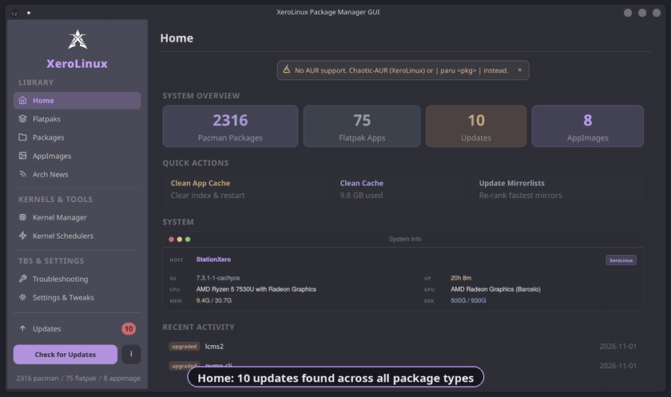

# xPackageManager

A package manager GUI for Arch Linux that manages **pacman**, **Flatpak** and **AppImage** from one interface. Built with Rust and [Slint](https://slint.dev).

Included by default on XeroLinux.



---

## Install on other Arch-based distros

Requires `base-devel` and `git`:

```bash
sudo pacman -S --needed base-devel git
git clone https://github.com/xerolinux/xPackageManager
cd xPackageManager/packaging && ./build.sh
```

To update, pull and rebuild:

```bash
cd xPackageManager && git pull
cd packaging && ./build.sh
```

---

## Changelog

### v0.9.0

- Improved performance on slower machines.
- Reset all settings to defaults from the Settings page.
- Installed AppImages are now detected wherever they live on the system.
- New Kernel Manager page: install and remove kernels grouped by family.
- New Kernel Schedulers page: switch sched-ext schedulers live, with flags reference and scheduler info.

### v0.8.1

- Startup sound (toggle in Settings) and a one-time welcome notice.
- Update popup split into one page per package type, with a result card for each.
- Opening an AppImage offers Run or Install, with a right-click action in Dolphin.

### v0.8.0

- New progress dialog with per-package progress.
- Update All with one confirmation for native, Flatpak and AppImage.
- Open `.AppImage`, `.flatpak`, `.flatpakref` and `.flatpakrepo` files with xpm.

### v0.7.0

- Faster, smoother interface and a cleaner look.
- App icons for native, Flatpak and AppImage packages.
- Update All now updates everything that is enabled in one run.
- Redesigned Flatpak info page with screenshots, details and release notes.
- One progress dialog for pacman, Flatpak and AppImage, with Yes/No confirmations.

### v0.6.x

- AppImage support, Flatpak permission editor and pacman rollback.

### v0.5.x

- Translations and more settings (HoldPkg, cache auto-clean, notifications, Flatpak remotes).

### v0.4.0

- Flatpak details with add-ons, dependency tree and activity log.
