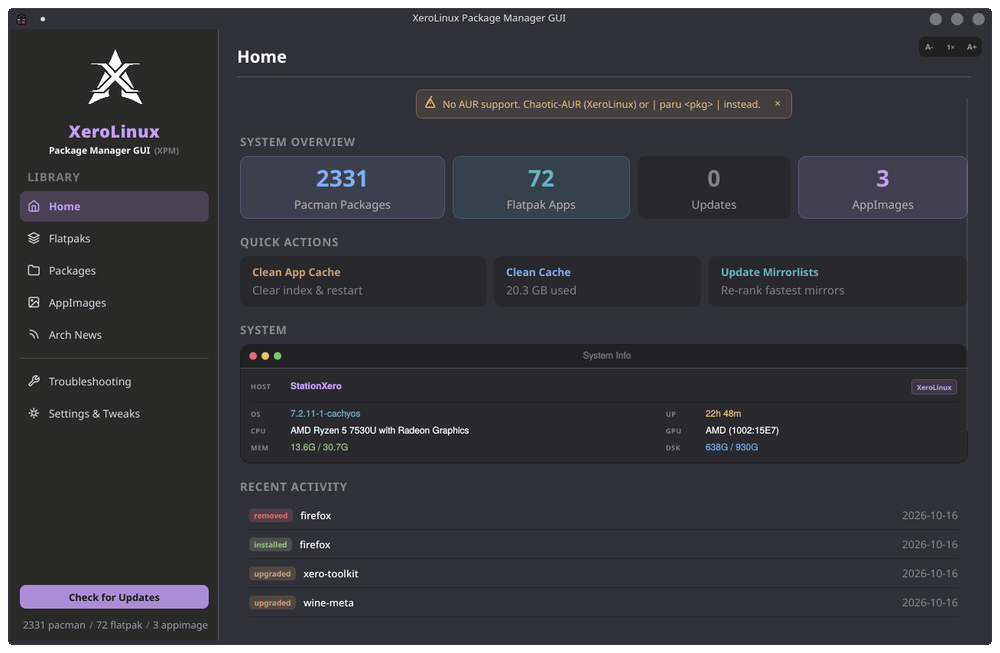

# xPackageManager

A package manager GUI for Arch Linux that manages **pacman**, **Flatpak** and **AppImage** from one interface. Built with Rust and [Slint](https://slint.dev).

Included by default on XeroLinux.



---

## Install on other Arch-based distros

Requires `base-devel` and `git`:

```bash
sudo pacman -S --needed base-devel git
git clone https://github.com/xerolinux/xPackageManager
cd xPackageManager/packaging && ./build.sh
```

To update, pull and rebuild:

```bash
cd xPackageManager && git pull
cd packaging && ./build.sh
```

---

## Changelog

### v0.7.0

- One progress dialog for pacman, Flatpak and AppImage, with Yes/No confirmations.
- Update All now updates everything that is enabled in one run.
- App icons for native, Flatpak and AppImage packages.
- Redesigned Flatpak info page with screenshots, details and release notes.
- Faster, smoother interface and a cleaner look.

### v0.6.x

- AppImage support, Flatpak permission editor and pacman rollback.

### v0.5.x

- Translations and more settings (HoldPkg, cache auto-clean, notifications, Flatpak remotes).

### v0.4.0

- Flatpak details with add-ons, dependency tree and activity log.
